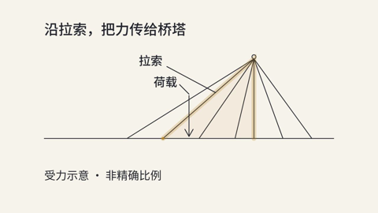

# 线条讲解：同音轨、同时间轴 A/B

这是一个可复现的讲解处理案例，不替换 `samples/line-art-sample.mp4`。画面由当前 line-art kit 重建；控制组不是无法取得的历史源工程的逐像素复刻。

[并排对照](comparison.mp4) · [控制组](control.mp4) · [教学组](teaching.mp4)



## 保持什么、改变什么

两版均为 1280×720、30fps、411 帧（画面 13.7 秒，保留原音轨后的容器 13.76 秒），使用同一份已有样片的 AAC 音轨。没有重新生成配音，也没有移动桥面、桥塔、拉索绘制、荷载箭头或线转面的 cue。

教学组显式启用 `styles/line-art/teaching.tsx`：

- 第 7 帧起读到「桥上的重量，由谁承担？」；为前半段缓慢描线提供观看理由。
- 荷载在第 255 帧、拉索在第 295 帧开始标注；第 261/301 帧完全可读。由 13px 改为 40px，重新放置引线，不覆盖受力路径。
- 第 323 帧填充结束后固定受力图，不再微呼吸。第 343–411 帧让一句结论和图一起稳定停留，共 69 帧（2.3 秒）。
- 必要的「非精确比例」说明保持可读；不再承担解释的英文微型装饰字不出现在教学组。

取舍：使用少量上部留白，牺牲一些纯展示片的空灵感，换取移动端解释任务的清晰度。`kit.tsx` 默认输出未改；需要纯展示时继续用原组件。

## 复现

需要 Node.js、npm、ffmpeg/ffprobe 和 Remotion 支持的 Chromium。**重新生成工程需要完整源码或 `--profile full` 包**：`core` 保留上述对照视频、代码和说明供查看，但省略准备脚本所需的 `samples/line-art-sample.mp4`。缺少该文件时脚本会在写入工程前报出明确提示；请按[可选样片安装说明](../../docs/package-profiles.md#optional-sample-videos)取得完整包，不会自动下载。已编码的对照视频音轨不是历史源音轨的逐字节替代。准备脚本拒绝已有目录，且校验历史音轨源 SHA256。

```sh
node examples/line-art-teaching/prepare.mjs /absolute/path/to/new-line-art-projects
cd /absolute/path/to/new-line-art-projects/control && npm ci
cd /absolute/path/to/new-line-art-projects/teaching && npm ci
# 回到 anything2video 仓库：
node scripts/check-plan.mjs /absolute/path/to/new-line-art-projects/control
node scripts/check-plan.mjs /absolute/path/to/new-line-art-projects/teaching
node scripts/render.mjs /absolute/path/to/new-line-art-projects/control video
node scripts/render.mjs /absolute/path/to/new-line-art-projects/teaching video
node scripts/render.mjs /absolute/path/to/new-line-art-projects/teaching stills 16,103,256,301,324,343,401
```

两版都注册 `LineArtControl` / `LineArtTeaching` 两个 Composition，由各自 `project.json` 选择。`research/control.json` 保存音轨源和提取后 SHA256；应相同。`N = useCurrentFrame() + 1`，这里与 kit 时间表均使用一基帧号。

如使用自备浏览器，将 `BROWSER_EXECUTABLE` 指向官方浏览器可执行文件。此次验证用 Remotion 固定版本的 Chrome Headless Shell；不要求更改系统权限。完整浏览器在部分受限环境无法启动，并不表示必须改写渲染器。

## 验证边界

数值字号检查只覆盖声明的大小与边界，不等于读懂了画面。实际帧、编码输出和静止区间的核验见 `verification.json`；没有听众理解度实验，也没有重新验收整套端到端生成流程。新主题必须重排标签并重新听看，不能照抄桥梁坐标和时间表。

## 素材与许可

- 代码：仓库 MIT；line-art 描线机制沿用原 kit 的 mg-styles-15 MIT 署名。
- 字体：仓库自带 Noto Sans SC / Noto Serif SC，SIL OFL；准备脚本复制许可文件。
- 音频：仅在本对照里复用 `samples/line-art-sample.mp4` 的既有 TTS、程序编曲 BGM 和 Mixkit 音效。来源与历史许可披露见 [samples/README.md](../../samples/README.md) 和 [samples/manifest.json](../../samples/manifest.json)。预览复制不扩大这些素材的使用许可；不要把提取音轨当作可自由再分发的素材包。
